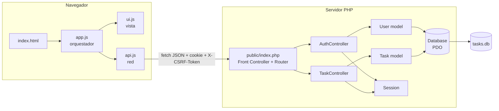
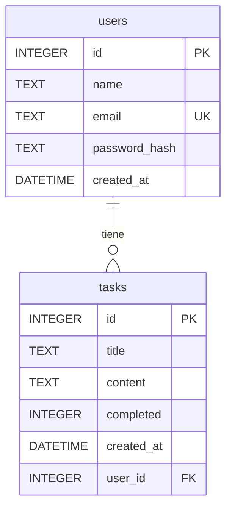
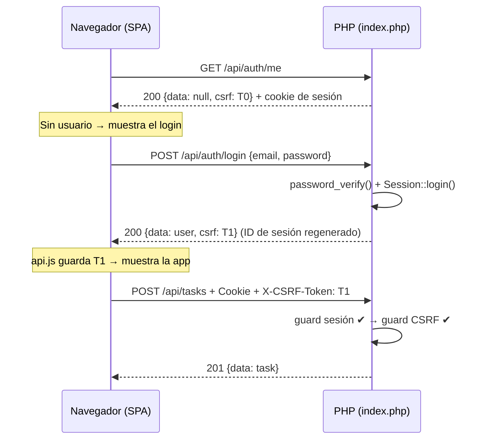
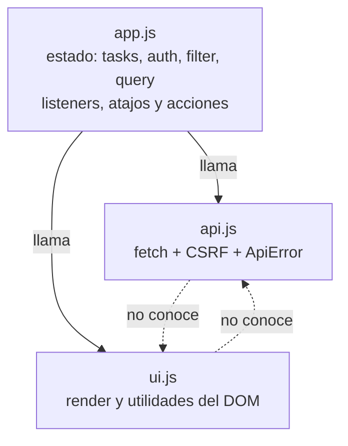
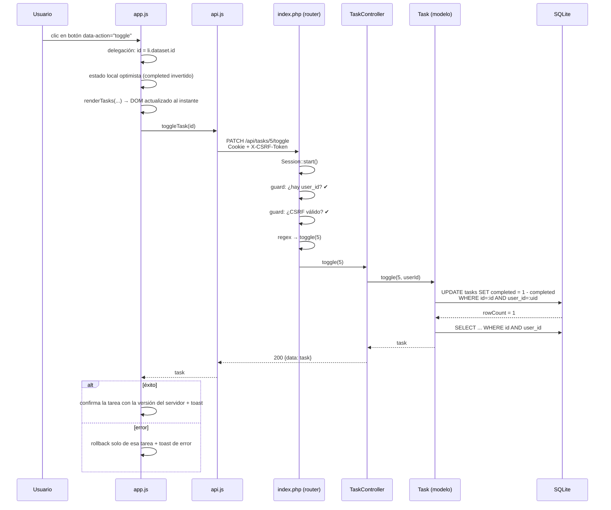
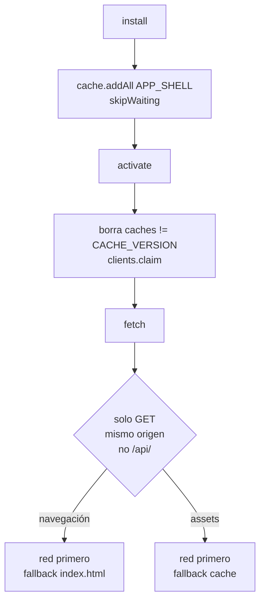

# TaskFlow: Todo App SPA con PHP + SQLite + Vanilla JS

Administrador de tareas multiusuario como **Single Page Application**. El backend es una API JSON en PHP puro (POO, MVC, PDO + SQLite) y el frontend usa JavaScript moderno con módulos ES6 y Tailwind CSS por CDN. No necesita Composer, Node ni MySQL.

Este README está pensado para **estudiar la arquitectura**: explica qué hace cada pieza, por qué está donde está y cómo viaja una petición de punta a punta.

---

## Índice

1. [Qué hace la aplicación](#1-qué-hace-la-aplicación)
2. [Stack y requisitos](#2-stack-y-requisitos)
3. [Cómo ejecutarlo](#3-cómo-ejecutarlo)
4. [Estructura de carpetas](#4-estructura-de-carpetas)
5. [Visión general de la arquitectura](#5-visión-general-de-la-arquitectura)
6. [Backend en detalle](#6-backend-en-detalle)
7. [Base de datos](#7-base-de-datos)
8. [Referencia de la API](#8-referencia-de-la-api)
9. [Autenticación, sesiones y CSRF](#9-autenticación-sesiones-y-csrf)
10. [Frontend en detalle](#10-frontend-en-detalle)
11. [Ciclo de vida de una petición](#11-ciclo-de-vida-de-una-petición)
12. [Seguridad: qué está cubierto](#12-seguridad-qué-está-cubierto)
13. [Decisiones de diseño y trade-offs](#13-decisiones-de-diseño-y-trade-offs)
14. [Limitaciones conocidas](#14-limitaciones-conocidas)
15. [Ejercicios para estudiar](#15-ejercicios-para-estudiar)
16. [PWA: instalación desde Chrome](#16-pwa-instalación-desde-chrome)
17. [Despliegue en InfinityFree (htdocs)](#17-despliegue-en-infinityfree-htdocs)
18. [Roadmap](#18-roadmap)

---

## 1. Qué hace la aplicación

- Registro e inicio de sesión de usuarios.
- Cada usuario ve, crea, completa y elimina **solo sus propias tareas**.
- Cada tarea tiene **título y contenido** con soporte de varias líneas, al estilo de Google Keep.
- Interfaz SPA: nunca se recarga la página; todo se hace con `fetch` y se repinta el DOM.
- Panel de estadísticas con pendientes, completadas, porcentaje y anillo de progreso.
- Filtros (todas / pendientes / completadas) y búsqueda instantánea con resaltado.
- Modo claro/oscuro persistente y respeto por la preferencia del sistema.
- Actualizaciones optimistas, notificaciones (toasts), estados vacíos contextuales y atajos de teclado.
- Topbar con el nombre del usuario, cambio de tema y botón de cerrar sesión.

---

## 2. Stack y requisitos

| Capa | Tecnología |
|---|---|
| Lenguaje backend | PHP 8.0+ (usa `match`, constructor promotion, `str_starts_with`) |
| Extensión necesaria | `pdo_sqlite` |
| Base de datos | SQLite (archivo local `database/tasks.db`) |
| Acceso a datos | PDO con sentencias preparadas |
| Frontend | JavaScript vanilla, módulos ES6 |
| Estilos | Tailwind CSS v4 vía CDN (`@tailwindcss/browser`) |
| Tipografía | Inter (Google Fonts) |
| Autenticación | Sesiones PHP nativas + token CSRF |

---

## 3. Cómo ejecutarlo

```bash
cd todoList
php -S localhost:8000 -t public public/index.php
```

Abre `http://localhost:8000`, crea una cuenta y empieza a añadir tareas.

- La carpeta `database/` debe ser **escribible** por el usuario que ejecuta PHP.
- El archivo `tasks.db` y las tablas se crean solos la primera vez que se hace una petición a la API.
- Para reiniciar los datos basta con borrar `database/tasks.db`.

**Apache/Nginx:** apunta el *document root* a `public/` y redirige todo lo que no sea un archivo existente hacia `index.php`.

> En hosting compartido (InfinityFree) no se puede mover el *document root*, así que el proyecto se despliega completo dentro de `htdocs` con un `.htaccess` que reescribe las rutas. Los detalles están en la [sección 17](#17-despliegue-en-infinityfree-htdocs).

---

## 4. Estructura de carpetas

```
todo-app/
├── .htaccess                     # Solo para htdocs: rewrites, bloqueos, MIME y caché
├── database/                     # tasks.db se genera aquí (fuera del document root)
│   └── .htaccess                 # Bloquea tasks.db por HTTP
├── src/                          # Código PHP, namespace raíz App\ (no es público)
│   ├── .htaccess                 # Bloquea el código PHP por HTTP
│   ├── Core/
│   │   ├── Database.php          # Conexión PDO + migración automática
│   │   ├── Http.php              # Helpers de respuesta JSON y lectura del body
│   │   └── Session.php           # Sesión, login/logout y CSRF
│   ├── Models/
│   │   ├── User.php              # Acceso a datos de usuarios
│   │   └── Task.php              # Acceso a datos de tareas (siempre filtradas por usuario)
│   └── Controllers/
│       ├── AuthController.php    # register / login / logout / me
│       └── TaskController.php    # index / store / toggle / destroy
└── public/                       # Document root: lo único expuesto al navegador
    ├── index.php                 # Front Controller + Router + autoloader PSR-4
    ├── index.html                # Shell de la SPA (topbar, auth, app, tema y estilos)
    ├── manifest.css              # Web App Manifest (extensión .css a propósito, ver §17.5)
    ├── sw.js                     # Service Worker (shell offline)
    ├── icons/                    # Iconos PNG de la PWA (any + maskable + apple-touch)
    └── js/
        ├── api.js                # Capa de red (fetch)
        ├── ui.js                 # Capa de vista (DOM)
        └── app.js                # Orquestador (eventos y estado)
```

**Por qué esta separación:** solo `public/` es accesible desde la web. El código PHP en `src/` y la base de datos en `database/` quedan fuera del *document root*, así que nadie puede descargarlos por URL.

> Cuando el proyecto se sube completo a `htdocs` (InfinityFree) esa separación ya no la da el servidor, así que la refuerza el `.htaccess` de la raíz: `src/`, `database/`, `docs/`, `vendor` y `.git` responden `403`, y cada una de esas carpetas tiene además su propio `.htaccess` como segunda barrera.

---

## 5. Visión general de la arquitectura



### Capas y responsabilidades

| Capa | Archivos | Responsabilidad | Lo que NO debe hacer |
|---|---|---|---|
| **Router / Front Controller** | `public/index.php` | Recibir toda petición, decidir si es estática o API, aplicar *guards* (sesión, CSRF) y despachar al controlador | Contener lógica de negocio o SQL |
| **Controlador** | `Controllers/*` | Leer la entrada, validarla, llamar al modelo, elegir el código HTTP y responder | Escribir SQL |
| **Modelo** | `Models/*` | Todas las consultas SQL y conversión de tipos | Conocer HTTP, JSON o sesiones |
| **Core / Infraestructura** | `Core/*` | Conexión a BD, sesión, helpers HTTP | Conocer reglas del dominio |
| **Vista (cliente)** | `ui.js` + `index.html` | Pintar el DOM | Hacer peticiones de red |
| **Red (cliente)** | `api.js` | Hablar con la API, gestionar CSRF y errores | Tocar el DOM |
| **Orquestador (cliente)** | `app.js` | Estado, eventos y coordinación entre `api.js` y `ui.js` | Construir HTML a mano |

### Patrón MVC aplicado a una API

- **M**odelo: `Task`, `User`.
- **C**ontrolador: `TaskController`, `AuthController`.
- **V**ista: en una API la "vista" es la respuesta JSON (`Http::json`). La interfaz visual vive en el cliente (`ui.js`).

---

## 6. Backend en detalle

### 6.1 Autoloader PSR-4 simulado

En `public/index.php`, `spl_autoload_register` convierte el namespace en una ruta:

```
App\Controllers\TaskController  →  src/Controllers/TaskController.php
```

Regla: el prefijo `App\` equivale a la carpeta `src/`, y cada `\` es un `/`. Es lo mismo que haría Composer con `"psr-4": {"App\\": "src/"}`, pero escrito a mano para no tener dependencias.

### 6.2 Front Controller y Router (`public/index.php`)

Un único punto de entrada para todo. Su flujo:

1. **Si la ruta no empieza con `/api/`:**
   - Si es un archivo existente en `public/` (por ejemplo `js/app.js`) → `return false`, y el servidor embebido lo sirve tal cual.
   - Si no → devuelve `index.html` (comportamiento típico de SPA).
2. **Si es `/api/...`:**
   - Inicia la sesión.
   - **Guard de autenticación:** las rutas `/api/tasks*` devuelven `401` si no hay sesión.
   - **Guard CSRF:** toda petición que no sea `GET`/`HEAD` exige el header `X-CSRF-Token` válido (excepto login y registro, que aún no tienen token).
   - Despacha por `ruta + método` al controlador. Las rutas con `{id}` se resuelven con expresiones regulares.
   - Un `try/catch` global convierte cualquier excepción en `500` sin filtrar detalles internos (el detalle va a `error_log`).

### 6.3 Clases del núcleo (`Core/`)

**`Database`** (singleton estático)
- Crea la carpeta `database/` si no existe.
- Abre PDO con `ERRMODE_EXCEPTION`, `FETCH_ASSOC` y `EMULATE_PREPARES = false` (preparadas reales).
- Activa `PRAGMA foreign_keys = ON` (SQLite lo trae desactivado por defecto).
- Ejecuta `migrate()` en cada primera conexión: crea `users` y `tasks` con `CREATE TABLE IF NOT EXISTS`. También detecta bases antiguas y añade `user_id` y `content` con `ALTER TABLE`.

**`Http`**
- `json($payload, $status)`: fija el código, el header `Content-Type: application/json` y emite el JSON.
- `body()`: lee `php://input` y devuelve siempre un array (vacío si el JSON es inválido).

**`Session`**
- Configura la cookie (`HttpOnly`, `SameSite=Lax`, `Secure` si hay HTTPS) y `use_strict_mode`.
- `login()` regenera el ID de sesión (previene *session fixation*) y genera el token CSRF.
- `logout()` vacía la sesión, expira la cookie y destruye la sesión.
- `validCsrf()` compara con `hash_equals` (comparación en tiempo constante).

### 6.4 Modelos

- Reciben un `PDO` por constructor (con valor por defecto `Database::getConnection()`), lo que permite inyectar una BD en memoria en tests.
- **Todos los métodos de `Task` reciben `$userId`** y lo incluyen en el `WHERE`. Es la barrera que garantiza el aislamiento entre usuarios.
- `cast()` convierte `id` a `int`, `completed` a `bool` y garantiza que `content` sea siempre un string.
- `create()` guarda título y contenido; el contenido es opcional y conserva los saltos de línea.
- `toggle()` usa `completed = 1 - completed` en una sola sentencia: es atómico, no hay *race condition* entre leer y escribir.
- `rowCount() > 0` indica si algo cambió; así `toggle` y `delete` saben si la tarea existía (y era del usuario).

### 6.5 Controladores

- Reciben su modelo por **inyección en el constructor** con un valor por defecto (`private Task $tasks = new Task()`), una forma ligera de inyección de dependencias.
- Validan la entrada antes de llegar al modelo (título obligatorio, máximo 255; contenido opcional, máximo 5000; nombre, email y contraseña en el registro).
- Devuelven siempre JSON con el código HTTP adecuado.
- `TaskController::uid()` toma el ID del usuario **de la sesión del servidor**, nunca del cliente.

---

## 7. Base de datos



- `tasks.user_id` referencia `users(id)` con `ON DELETE CASCADE`: al borrar un usuario se borran sus tareas.
- `users.email` es `UNIQUE`; el controlador captura el error SQLSTATE `23000` y responde `409`.
- Índice `idx_tasks_user` sobre `tasks(user_id)` para acelerar el listado por usuario.
- `completed` es `INTEGER` (SQLite no tiene booleano); el modelo lo convierte a `bool`.
- `content` es `TEXT NOT NULL DEFAULT ''`: las tareas antiguas reciben una cadena vacía al migrar.

---

## 8. Referencia de la API

Todas las respuestas son `application/json; charset=utf-8`.

### Autenticación

| Método | Ruta | Cuerpo | Respuesta |
|---|---|---|---|
| `GET` | `/api/auth/me` | n/a | `200` `{data: user \| null, csrf}` |
| `POST` | `/api/auth/register` | `{name, email, password}` | `201` `{data: user, csrf}` · `400` · `409` |
| `POST` | `/api/auth/login` | `{email, password}` | `200` `{data: user, csrf}` · `401` |
| `POST` | `/api/auth/logout` | n/a | `200` `{message}` (requiere CSRF) |

### Tareas (requieren sesión)

| Método | Ruta | Cuerpo | Respuesta |
|---|---|---|---|
| `GET` | `/api/tasks` | n/a | `200` `{data: Task[]}` |
| `POST` | `/api/tasks` | `{title, content?}` | `201` `{data: Task}` · `400` |
| `PATCH` | `/api/tasks/{id}/toggle` | n/a | `200` `{data: Task}` · `404` |
| `DELETE` | `/api/tasks/{id}` | n/a | `200` `{message}` · `404` |

> **Method override:** algunos hostings compartidos (InfinityFree) solo aceptan `GET` y `POST`. `public/index.php` lee el header `X-HTTP-Method-Override` y, si la petición es `POST`, la trata como `PATCH`, `PUT` o `DELETE`. `api.js` usa este mecanismo para `toggleTask` y `deleteTask`, así que el contrato de la API no cambia: sigue siendo `PATCH`/`DELETE` desde el punto de vista del cliente.

### Códigos de estado usados

| Código | Cuándo |
|---|---|
| `200` | Consulta, toggle, borrado, login |
| `201` | Recurso creado (tarea, usuario) |
| `400` | Validación fallida |
| `401` | Sin sesión, o credenciales incorrectas |
| `403` | Token CSRF inválido o ausente |
| `404` | Ruta inexistente, o tarea que no existe **o no es del usuario** |
| `405` | Método no permitido en `/api/tasks` |
| `409` | Email ya registrado |
| `500` | Excepción no controlada |

### Ejemplo con `curl`

```bash
# 1. Obtener cookie de sesión y token CSRF
curl -c jar.txt http://localhost:8000/api/auth/me

# 2. Registrarse (login y registro no requieren CSRF)
curl -b jar.txt -c jar.txt -X POST http://localhost:8000/api/auth/register \
  -H 'Content-Type: application/json' \
  -d '{"name":"Ana","email":"ana@example.com","password":"secreto123"}'
# → copia el valor de "csrf" de la respuesta

# 3. Crear una tarea (requiere el header CSRF)
curl -b jar.txt -X POST http://localhost:8000/api/tasks \
  -H 'Content-Type: application/json' \
  -H 'X-CSRF-Token: <TOKEN>' \
  -d '{"title":"Estudiar la arquitectura","content":"Empezar por index.php\nSeguir con los controladores"}'
```

---

## 9. Autenticación, sesiones y CSRF

### Flujo completo



### Por qué cada mecanismo

| Mecanismo | Problema que resuelve |
|---|---|
| Cookie `HttpOnly` | JavaScript no puede leer la cookie, así un XSS no la roba |
| Cookie `SameSite=Lax` | El navegador no envía la cookie en peticiones cruzadas mutantes, primera defensa contra CSRF |
| Token CSRF en header | Defensa adicional: un sitio externo no puede leerlo ni añadirlo |
| `session_regenerate_id(true)` | Evita *session fixation* al iniciar sesión |
| `password_hash` / `password_verify` | Contraseñas nunca en claro; sal y algoritmo gestionados por PHP |
| Mensaje genérico en login | No revela si un correo está registrado |
| Cálculo de hash cuando el usuario no existe | Iguala tiempos de respuesta (mitiga enumeración por tiempo) |
| 404 (no 403) para tareas ajenas | No revela que el recurso existe |
| Límite de 72 caracteres en la contraseña | Bcrypt trunca a 72 bytes; se rechaza para no aceptar contraseñas "recortadas" en silencio |

---

## 10. Frontend en detalle

### 10.1 Tres módulos con responsabilidad única



`api.js` y `ui.js` **no se conocen entre sí**. Solo `app.js` los coordina. Esto los hace sustituibles y fáciles de probar por separado.

### 10.2 `api.js`: capa de red

- Función única `request()` que añade `Content-Type`, `credentials: 'same-origin'` y, en métodos distintos de `GET`, el header `X-CSRF-Token`.
- Guarda en una variable de módulo el token que llega en las respuestas (`payload.csrf`).
- Lanza `ApiError` (con `status`) si la respuesta no es `ok`, de modo que `app.js` puede distinguir un `401` de otros errores.
- Exporta funciones de alto nivel: `getSession`, `login`, `register`, `logout`, `getTasks`, `createTask`, `toggleTask`, `deleteTask`.

### 10.3 `ui.js`: capa de vista

- Cachea las referencias al DOM una sola vez (`els`).
- `createTaskItem()` construye cada `<li>` con `createElement` y `textContent`, pinta el título y, si existe, el contenido con `whitespace-pre-line` para conservar los saltos de línea. El resaltado de búsqueda lo hace `appendHighlightedText()`, que inserta nodos de texto y `<mark>`, **nunca `innerHTML` con datos del usuario** → sin XSS.
- `renderTasks(tasks, { filter, query })` filtra en memoria (la búsqueda mira título **y** contenido), repinta con `replaceChildren()` y actualiza contadores, estadísticas y estados vacíos. Mientras hay búsqueda activa no anima la entrada de cada fila, para no parpadear en cada pulsación.
- `formatCreatedAt()` normaliza las fechas UTC que devuelve SQLite (les añade `Z`) y las muestra en formato relativo: «Ahora mismo», «Hace 5 min», «Hoy · 14:32», «Ayer · 09:10»...
- `updateStats()` calcula pendientes, completadas y porcentaje, y sincroniza las tarjetas, la barra, el anillo SVG y los mensajes de ánimo.
- **Tema:** `initTheme()`, `applyTheme()` y `toggleTheme()` combinan `localStorage` con `prefers-color-scheme` y actualizan el `aria-pressed` del botón y el `theme-color`.
- **Toasts:** `showToast(message, type)` crea notificaciones accesibles (`aria-live`), con cierre manual y un máximo de tres simultáneas.
- **Animaciones:** usa la Web Animations API (`animateTaskToggle()`, `animateTaskRemoval()`, etc.) y respeta `prefers-reduced-motion`.
- Otras funciones de vista: `showAuth()`, `showApp(user)`, `setAuthMode()`, `setAuthBusy()`, `showError()`, `setLoading()`, `setClearCompletedConfirm()`...

### 10.4 `app.js`: orquestador

- Guarda el estado (`tasks`, `authMode`, `filter`, `query`, `busyIds`, `clearConfirm`) y registra los eventos.
- **`handleSessionError(error)`**: punto único para detectar un `401` (sesión expirada), volver al login y avisar con un toast.
- **Delegación de eventos:** un solo listener en `<ul>` captura los clics de todos los botones mediante `data-action="toggle|delete"` y `closest('li').dataset.id`. Funciona aunque la lista se repinte.
- **Crear tarea:** lee `title` y `content` del formulario, envía ambos a la API y limpia el compositor (incluida la altura del textarea).
- **Filtros y búsqueda:** el filtro se guarda en `filter`; la búsqueda aplica un *debounce* de 120 ms antes de repintar.
- **UI optimista:**
  - `toggle` invierte el estado local y repinta al instante; si la API falla, revierte **solo esa tarea** (no pisa otras acciones en curso).
  - `delete` anima la salida, elimina la fila y, si la petición falla, la restaura en su índice original.
  - `busyIds` evita que un doble clic dispare dos peticiones para la misma tarea.
- **Limpiar completadas:** exige un segundo clic en menos de 3,5 s. Borra en paralelo y, si alguna petición falla, restaura únicamente esas tareas.
- **Atajos:** `N` enfoca el título, `/` la búsqueda, `Ctrl + ↵` guarda desde el contenido y `Esc` limpia la búsqueda o quita el foco.
- **`init()`**: pregunta `GET /api/auth/me`; si hay usuario entra a la app, si no muestra el login.

### 10.5 Dos vistas en una sola página

`index.html` contiene `#auth-view` y `#app-view`. `ui.js` alterna la clase `hidden` de Tailwind entre ambas. El topbar siempre está visible; el área de usuario (`#user-area`) solo aparece con sesión activa.

### 10.6 Decisiones de UI/UX

- **Sin parpadeo de tema:** un script inline en `<head>` aplica la clase `dark` antes de pintar y antes de cargar Tailwind. Así el primer frame ya usa el tema guardado.
- **Responsive mobile-first:** las estadísticas son tres columnas desde el móvil, el panel lateral aparece a partir de `lg` y la tarjeta de autenticación pasa a dos columnas en escritorio.
- **Accesibilidad:** pestañas con `role="tab"` + `aria-selected`, checkbox con `role="checkbox"` + `aria-checked`, progreso con `aria-valuenow`, toasts en una región `aria-live` y anillos de foco visibles.
- **Compositor tipo nota:** título y contenido en una sola tarjeta sin bordes internos; el textarea crece con el texto hasta un máximo y luego hace scroll. `Ctrl + ↵` guarda sin salir del contenido.
- **Feedback inmediato:** skeletons al cargar, botones deshabilitados con spinner, toasts de éxito/error, confirmación en dos pasos y estados vacíos que cambian según el filtro o la búsqueda.
- **Movimiento con propósito:** animaciones cortas con la Web Animations API y desactivadas cuando el sistema pide movimiento reducido.

---

## 11. Ciclo de vida de una petición

Ejemplo: el usuario hace clic en el círculo de una tarea para completarla. La interfaz se actualiza de forma optimista antes de la respuesta y revierte si la API falla.



---

## 12. Seguridad: qué está cubierto

| Amenaza | Protección |
|---|---|
| Inyección SQL | Sentencias preparadas con parámetros nombrados y `EMULATE_PREPARES = false` |
| XSS | `textContent` y nodos `<mark>` en el cliente (título y contenido); JSON codificado con `json_encode` |
| CSRF | Cookie `SameSite=Lax` + token en header validado con `hash_equals` |
| Robo de sesión por JS | Cookie `HttpOnly` |
| Session fixation | `session_regenerate_id(true)` en el login |
| Acceso a datos ajenos (IDOR) | Todas las consultas filtran por `user_id` tomado de la sesión |
| Fuga de contraseñas | `password_hash()`; el hash nunca se envía al cliente |
| Enumeración de usuarios | Mensaje de error genérico y tiempos igualados |
| Exposición de código y BD | Fuera del *document root* |
| Fuga de errores internos | `500` genérico; el detalle se registra en el log |

---

## 13. Decisiones de diseño y trade-offs

| Decisión | Ventaja | Coste / alternativa |
|---|---|---|
| **SQLite** | Cero configuración, un solo archivo | No escala a mucha concurrencia de escritura; para producción real → MySQL/PostgreSQL |
| **Sesiones PHP** (no JWT) | Simples, revocables en el servidor, cookie `HttpOnly` | Estado en el servidor; en varios servidores necesitas almacenamiento compartido |
| **Autoloader manual** | Sin dependencias | En un proyecto real se usa Composer |
| **Router con `if/elseif` + regex** | Muy fácil de leer | No escala; el siguiente paso es una clase `Router` con tabla de rutas |
| **`Database` estática (singleton)** | Una sola conexión reutilizada | Dificulta tests; mitigado porque los modelos aceptan un `PDO` inyectado |
| **Migración en cada conexión** | Autocreación sin pasos manuales | Pequeño coste por petición; mejor con migraciones versionadas |
| **Repintado completo de la lista** | Código mínimo y sin desincronización | Con miles de tareas convendría actualizar solo los nodos cambiados |
| **UI optimista con rollback** | Respuesta inmediata al usuario | Hay que revertir el estado si la API falla y cuidar las acciones concurrentes |
| **Filtros y búsqueda en cliente** | Cero peticiones extra y resultados instantáneos | Con muchas tareas conviene paginar y filtrar en el servidor |
| **Script inline para el tema** | Evita el destello de tema incorrecto al cargar | La clave de `localStorage` se repite en `index.html` y `ui.js` |
| **Tailwind CDN** | Cero build | No recomendado en producción; usar la CLI con purga de CSS |
| **404 en lugar de 403** para recursos ajenos | No revela existencia | Menos explícito al depurar |

---

## 14. Limitaciones conocidas

- **Sin rate limiting** en login/registro: vulnerable a fuerza bruta en producción.
- **Sin `Content-Security-Policy`**: el `.htaccess` de despliegue ya envía `X-Content-Type-Options`, `X-Frame-Options` y `Referrer-Policy`, pero el CDN de Tailwind complica una CSP estricta.
- **Sin verificación de correo ni recuperación de contraseña.**
- **Sin tests automatizados.**
- **Tareas huérfanas:** si vienes de la versión sin usuarios, esas tareas tienen `user_id NULL` y nadie las ve. Para asignarlas: `UPDATE tasks SET user_id = 1 WHERE user_id IS NULL;`
- **Sin paginación:** `GET /api/tasks` devuelve todas las tareas del usuario.
- **Sin edición de títulos ni contenido.** Los filtros y la búsqueda existen solo en el cliente y no se conservan al recargar.
- **Servir por HTTPS en producción:** la cookie activa `Secure` solo si detecta HTTPS.

---

## 15. Ejercicios para estudiar

Ordenados de menor a mayor dificultad. Cada uno te obliga a tocar una capa distinta.

1. **Edición de título y contenido:** añade `PATCH /api/tasks/{id}` (modelo `update()`, método `update()` en el controlador, ruta en `index.php`, función en `api.js` y edición en `ui.js`).
2. **Persistencia de filtros y búsqueda:** guarda `filter` y `q` en la URL (`?filter=pending&q=informe`) y restáuralos en `init()`. Sin tocar el backend.
3. **Borrado masivo eficiente:** añade `DELETE /api/tasks/completed` con una sola sentencia SQL, en lugar de una petición por tarea. Ojo: la ruta debe evaluarse *antes* que la de `{id}`.
4. **Clase `Router`:** extrae el `if/elseif` a una clase con `get()`, `post()`, `patch()`, `delete()` y soporte de parámetros `{id}`.
5. **Clase `Request`:** encapsula método, ruta, body y headers para que los controladores no lean `php://input`.
6. **Tests con SQLite en memoria:** instancia `new Task(new PDO('sqlite::memory:'))`, ejecuta la migración y prueba que un usuario no puede ver las tareas de otro.
7. **Rate limiting:** tabla `login_attempts` (IP + fecha) y bloqueo tras N intentos fallidos.
8. **Sincronización entre pestañas:** usa `BroadcastChannel` o el evento `storage` para que dos pestañas abiertas mantengan la misma lista.
9. **Migraciones versionadas:** carpeta `migrations/` con archivos SQL numerados y una tabla `migrations` que registre cuáles se aplicaron.
10. **Composer + PSR-4 real:** reemplaza el autoloader por `vendor/autoload.php`.

### Preguntas de autoevaluación

- ¿Por qué `toggle` usa `1 - completed` en vez de leer y luego escribir?
- ¿Qué pasaría si `Task::all()` no recibiera `$userId`?
- ¿Por qué `/api/auth/me` devuelve `200` con `data: null` en lugar de `401`?
- ¿Por qué el token CSRF se entrega en el cuerpo JSON y no en una cookie legible?
- ¿Qué ocurre si la sesión expira mientras el usuario tiene la app abierta? Sigue el flujo hasta `resetToAuth()`.
- ¿Por qué `api.js` no importa nada de `ui.js`?
- ¿Por qué el resaltado de búsqueda construye nodos de texto en vez de usar `innerHTML`?
- En la UI optimista, ¿por qué el rollback de `toggle` solo modifica la tarea afectada?
- ¿Qué cambia si el servidor pasa a varias máquinas y las sesiones están en archivos locales?

---

## 16. PWA: instalación desde Chrome

La app se puede **instalar** desde Chrome (escritorio y Android) y abrirse en su propia ventana, sin barra de direcciones, con icono en el sistema.

### 16.1 Piezas añadidas

| Archivo | Función |
|---|---|
| `public/manifest.css` | Web App Manifest: identidad, colores, `start_url`, `scope` e iconos. La extensión `.css` es intencional ([§17.5](#175-el-reto-anti-bot-y-el-manifest-css)) |
| `public/sw.js` | Service Worker: shell cacheado y fallback offline básico |
| `public/icons/` | 5 PNG: `icon-192`, `icon-512`, `icon-maskable-192`, `icon-maskable-512`, `apple-touch-icon-180` |
| `public/index.html` | `<link rel="manifest">`, `apple-touch-icon` y metas `apple-mobile-web-app-*` |
| `public/js/app.js` | Registro del Service Worker |
| `.htaccess` | `ForceType application/manifest+json` para que el manifest se sirva con el MIME correcto pese a llamarse `.css` |
| `public/js/api.js` | *Method override* para `PATCH`/`DELETE` (necesario en el hosting, ver [§17.4](#174-method-override-patchdelete)) |

### 16.2 Qué exige Chrome para ofrecer la instalación

1. **HTTPS** (o `localhost`/`127.0.0.1`, que cuentan como contexto seguro).
2. Un **manifest enlazado** desde el HTML, que responda `200` y con MIME `application/manifest+json` o `application/json`.
3. `name` (o `short_name`), `icons` con **192×192 y 512×512**, `start_url` y `display` distinto de `browser`.
4. Un **Service Worker con handler `fetch`**: desde Chrome 108/112 ya **no es obligatorio** para instalar, pero se incluye igualmente porque aporta apertura offline y arranque más rápido.

### 16.3 El manifest

```json
{
  "id": "/",
  "name": "TaskFlow — Administrador de tareas",
  "short_name": "TaskFlow",
  "start_url": "/",
  "scope": "/",
  "display": "standalone",
  "background_color": "#f8fafc",
  "theme_color": "#4f46e5",
  "icons": [
    { "src": "/icons/icon-192.png",          "sizes": "192x192", "type": "image/png", "purpose": "any" },
    { "src": "/icons/icon-512.png",          "sizes": "512x512", "type": "image/png", "purpose": "any" },
    { "src": "/icons/icon-maskable-192.png", "sizes": "192x192", "type": "image/png", "purpose": "maskable" },
    { "src": "/icons/icon-maskable-512.png", "sizes": "512x512", "type": "image/png", "purpose": "maskable" }
  ]
}
```

- `start_url` y `scope` son `/` porque la app vive en la raíz del dominio (`https://listify.infinityfreeapp.com/`).
- `id` fija la **identidad** de la app instalada. Si se cambia, Chrome la considera otra aplicación distinta.
- `theme_color` tiñe la barra de estado/ventana; `background_color` es el color de la pantalla de arranque.
- `display_override: ["standalone", "minimal-ui"]` permite degradar a `minimal-ui` en plataformas que no soportan `standalone`.

### 16.4 Iconos

| Archivo | Tamaño | `purpose` | Detalle |
|---|---|---|---|
| `icon-192.png` | 192×192 | `any` | Fondo redondeado y esquinas **transparentes** |
| `icon-512.png` | 512×512 | `any` | Igual, para pantallas de alta densidad |
| `icon-maskable-192.png` | 192×192 | `maskable` | **Full bleed**: el fondo cubre todo el lienzo |
| `icon-maskable-512.png` | 512×512 | `maskable` | Igual, a mayor resolución |
| `apple-touch-icon-180.png` | 180×180 | — | iOS no admite transparencia; fondo sólido |

Los `maskable` existen porque Android **recorta** el icono con la forma del lanzador (círculo, gota, cuadrado redondeado). Por eso el fondo ocupa todo el lienzo y el check queda dentro de la **zona segura** (el 80 % central): así ningún recorte lo corta. Los `any` mantienen esquinas transparentes para el escritorio.

### 16.5 El Service Worker (`public/sw.js`)



- **Versión de caché:** `const CACHE_VERSION = 'taskflow-v2'`. Al desplegar cambios en el shell hay que **subir la versión** para que `activate` borre la caché anterior.
- **Precache:** `/`, `/manifest.css`, los cinco iconos y `js/app.js`, `js/api.js`, `js/ui.js`. Si alguno de esos archivos faltara, `cache.addAll` fallaría y el SW no se instalaría: la lista debe mantenerse sincronizada con la realidad.
- **Nunca cachea `/api/`:** las respuestas llevan datos privados del usuario y estado (CSRF); servirlas desde caché rompería la sesión y mostraría datos obsoletos.
- **Red primero, caché como respaldo:** así nunca se sirve un JS viejo tras un despliegue, pero si no hay conexión la app sigue abriendo.
- **`skipWaiting()` + `clients.claim()`:** la versión nueva toma el control sin obligar al usuario a cerrar todas las pestañas.

### 16.6 Registro

```js
/* public/js/app.js */
if ('serviceWorker' in navigator) {
  window.addEventListener('load', () => {
    navigator.serviceWorker.register('/sw.js').catch(() => {
      // Sin service worker la app sigue funcionando con normalidad.
    });
  });
}
```

Se registra en `load` para no competir con la primera pintura. El `catch` es deliberado: la PWA es una mejora progresiva, nunca un requisito para usar la app.

### 16.7 Cómo se instala

- **Chrome de escritorio:** icono de instalar en la barra de direcciones, o menú **⋮ → «Instalar TaskFlow»**. Se abre en una ventana propia.
- **Chrome en Android:** menú **⋮ → «Instalar aplicación» / «Añadir a pantalla de inicio»**.
- **iOS (Safari):** Compartir → «Añadir a pantalla de inicio» (usa `apple-touch-icon`).

### 16.8 Cómo verificarlo

En DevTools:

| Panel | Qué debe mostrar |
|---|---|
| **Application → Manifest** | Nombre, `start_url: /`, `display: standalone` y los 4 iconos, sin errores |
| **Application → Service Workers** | `/sw.js` en estado *activated and is running*, con scope `/` |
| **Application → Cache Storage** | `taskflow-v2` con el shell |
| **Console** | Sin errores de manifest ni de SW |

Comprobación real registrada en local (`http://127.0.0.1:8766`):

```
swRegistered: true   swActive: "activated"   controller: true
swScope: http://127.0.0.1:8766/
manifest: 200 application/json  name="TaskFlow — Administrador de tareas"
icons: 192x192/any, 512x512/any, 192x192/maskable, 512x512/maskable
caches: ["taskflow-v2"]  ·  recarga con SW controlando: OK  ·  consola: 0 errores
```

---

## 17. Despliegue en InfinityFree (htdocs)

### 17.1 Restricciones que condicionan el diseño

| Restricción del hosting | Consecuencia en el proyecto |
|---|---|
| El *document root* es **`htdocs`** y no se puede cambiar | Opción B: se sube el repo **completo** dentro de `htdocs` y un `.htaccess` hace de puente |
| Solo permite `GET` y `POST` | *Method override* para `PATCH` y `DELETE` |
| Anti-bot con `/aes.js` y cookie `__test` | El manifest se sirve desde una ruta `.css` |
| HTTPS con certificado propio | Requisito de PWA cumplido, y la cookie de sesión puede ir con `Secure` |
| Sin SSH ni Composer | Autoloader manual (ya lo era) y SQLite como base de datos |

### 17.2 Estructura en el servidor

```
htdocs/                          ← document root real del hosting
├── .htaccess                   ← rewrites, bloqueos, MIME y caché
├── public/                     ← la app (front controller + assets)
│   ├── index.php
│   ├── index.html
│   ├── manifest.css
│   ├── sw.js
│   ├── icons/
│   └── js/
├── src/                        ← código PHP (protegido por .htaccess)
├── database/                   ← tasks.db (protegido por .htaccess)
└── docs/                       ← documentación (protegida por .htaccess)
```

### 17.3 El `.htaccess` de la raíz, regla por regla

| # | Regla | Para qué |
|---|---|---|
| 1 | `^(src|database|docs|vendor)(/|$)` → `[F]` | Devuelve `403`: nadie descarga el código, la base de datos ni la documentación |
| 1 | `^\.git`, `README.md`, `.env*` → `[F]` | No exponer repositorio ni secretos |
| 2 | `^public/` → `[L]` | Si se entra por `/public/...`, se sirve el archivo tal cual |
| 3 | `^api(/.*)?$` → `public/index.php` `[QSA,L]` | La API siempre pasa por el front controller (que sigue viendo `/api/...` en `REQUEST_URI`) |
| 4 | `RewriteCond %{DOCUMENT_ROOT}/public/$1 -f` | Los assets reales (`/js/app.js`, `/icons/...`, `/manifest.css`) se sirven desde `public/` |
| 5 | `^(.*)$` → `public/index.html` | Cualquier otra ruta devuelve la SPA |

Además:

- `AddType application/json .json` y `ForceType application/manifest+json` para `manifest.css`.
- `Header always set X-Content-Type-Options`, `Referrer-Policy` y `X-Frame-Options: DENY`.
- `Cache-Control: no-cache, must-revalidate` para `.html .php .js .css .json`, de modo que un despliegue se ve con **un solo Ctrl + F5**.

Ejemplos de resolución:

| Petición | Se sirve |
|---|---|
| `GET /` | `public/index.html` |
| `GET /js/app.js` | `public/js/app.js` |
| `GET /manifest.css` | `public/manifest.css` con MIME de manifest |
| `GET /api/tasks` | `public/index.php` → `TaskController::index()` |
| `GET /src/Core/Database.php` | `403` |
| `GET /database/tasks.db` | `403` |

### 17.4 Method override (`PATCH`/`DELETE`)

El hosting rechaza `PATCH`, `PUT` y `DELETE` con `405`, así que el cliente los envía como `POST` con un header que el router traduce:

```js
/* public/js/api.js */
export const toggleTask = async (id) =>
  (await request(`${BASE_URL}/${id}/toggle`, {
    method: 'POST',
    headers: { 'X-HTTP-Method-Override': 'PATCH' },
  })).data;

export const deleteTask = (id) =>
  request(`${BASE_URL}/${id}`, {
    method: 'POST',
    headers: { 'X-HTTP-Method-Override': 'DELETE' },
  });
```

```php
/* public/index.php */
$method   = $_SERVER['REQUEST_METHOD'] ?? 'GET';
$override = strtoupper($_SERVER['HTTP_X_HTTP_METHOD_OVERRIDE'] ?? '');

if ($method === 'POST' && in_array($override, ['PATCH', 'PUT', 'DELETE'], true)) {
    $method = $override;
}
```

- Solo se permite **POST → PATCH/PUT/DELETE**, nunca al revés, así que no se puede "escapar" del guard CSRF subiendo de método.
- El guard CSRF sigue aplicándose porque la petición *real* es `POST` y no está en la lista de exentas.
- El resto de la API (`GET`, `POST`) funciona igual en local y en producción: el override es transparente.

### 17.5 El reto anti-bot y el manifest `.css`

InfinityFree interpone un módulo `testcookie` que sirve `/aes.js`: si la petición **no** trae la cookie `__test`, responde `200 text/html` con una página que calcula la cookie en JavaScript y recarga. Es decir, responde HTML **en lugar del archivo pedido**.

Sondas reales contra `https://listify.infinityfreeapp.com` **sin** cookie:

| URL | Respuesta |
|---|---|
| `/manifest.json` | reto HTML (`aes.js`) |
| `/sw.js` | reto HTML |
| `/js/app.js` | reto HTML |
| `/api/auth/me` | reto HTML |
| `/icons/icon-192.png` | **PNG real** (exento) |
| `/nada.css` | **exento** (sin reto) |

Y aquí está el detalle que rompía la PWA: **Chrome pide el manifest sin cookies** (comportamiento del navegador, no configurable desde la página). Recibía el HTML del reto y su parser JSON lo reportaba como:

```
Manifest: Line: 1, column: 1, Syntax error.
```

Mientras que abrir `/manifest.json` a mano *sí* funcionaba, porque ahí el navegador ejecuta `aes.js`, se coloca la cookie y recarga.

**Solución:** servir el manifest desde una ruta exenta del reto y forzar el MIME:

```apache
<Files "manifest.css">
    ForceType application/manifest+json
</Files>
```

- El archivo es `public/manifest.css` y contiene JSON puro.
- `index.html` lo enlaza como `<link rel="manifest" href="/manifest.css">`.
- El Service Worker lo precachea en `APP_SHELL`.
- `sw.js` e iconos **no** necesitan truco: el SW se registra con credenciales (recibe la cookie) y los PNG ya están exentos.

> Lo mismo explica el «error de CORS» que aparecía antes de tener `.htaccess`: el servidor redirigía a `errors.infinityfree.net` y el navegador lo interpretaba como fallo de CORS. No era CORS, era la petición devolviendo HTML/redirección.

### 17.6 Qué subir y qué no

**Subir a la raíz de `htdocs`:**

- `.htaccess`
- `public/` completo (`index.php`, `index.html`, `manifest.css`, `sw.js`, `icons/`, `js/`)
- `src/`
- `database/` (la carpeta, **sin** el `tasks.db` local)
- `docs/` (opcional)

**No subir:**

- `database/tasks.db` con datos locales: sobrescribiría los usuarios y tareas reales. El esquema (`users`, `tasks`) se crea solo en la primera petición gracias a `Database::migrate()`.
- `todoList.zip` ni copias comprimidas del repo.

**Requisitos:** `database/` debe tener permiso de escritura para que SQLite pueda crear el archivo.

### 17.7 Verificación en producción

| Comprobación | Esperado |
|---|---|
| `GET /` | `200` con el HTML de la SPA |
| `GET /manifest.css` | `200` con `application/manifest+json` |
| `GET /sw.js` | `200` con `application/javascript` |
| `GET /icons/icon-192.png` | `200` con `image/png` |
| `GET /api/auth/me` | `200` con JSON y `csrf` |
| `GET /src/Core/Database.php` | `403` |
| `GET /database/tasks.db` | `403` |
| Crear / completar / eliminar tarea | `201` / `200` / `200`, nunca `405` |
| DevTools → Application | Manifest sin errores, SW activo, caché `taskflow-v2` |

### 17.8 Problemas típicos

| Síntoma | Causa | Solución |
|---|---|---|
| `404` en todas las rutas | Falta el `.htaccess` en `htdocs` (o `mod_rewrite`) | Subirlo a la raíz y comprobar que `RewriteEngine On` se aplica |
| «CORS error» en la API | Redirección a `errors.infinityfree.net` por falta de reescritura | Mismo caso: es el `.htaccess` |
| `405` al completar o eliminar | El hosting no acepta `PATCH`/`DELETE` | Method override de [§17.4](#174-method-override-patchdelete) |
| `Manifest: Line: 1, column: 1, Syntax error` | Anti-bot devolviendo HTML por falta de cookie | Enlazar `/manifest.css` con `ForceType` ([§17.5](#175-el-reto-anti-bot-y-el-manifest-css)) |
| Se ven CSS/JS viejos tras desplegar | Caché del navegador | `Ctrl + F5` una vez; el `.htaccess` ya manda `no-cache` |
| `500` sin detalle en la respuesta | Excepción no controlada o `database/` sin permisos | Revisar `error_log` y permisos de `database/` |
| Chrome no ofrece instalar | Falta HTTPS, manifest con MIME incorrecto o icono 512 | Revisar Application → Manifest y la pestaña Network |

---

## 18. Roadmap

Siguientes pasos naturales, en orden de impacto:

1. **Edición de tareas** (`PATCH /api/tasks/{id}`) para completar el CRUD.
2. **`Content-Security-Policy`** junto con un build de Tailwind (sin CDN) para poder aplicarla de verdad.
3. **Tests automatizados** del backend con SQLite en memoria (aislamiento entre usuarios incluido).
4. **Rate limiting** en login/registro y verificación de correo.
5. **Paginación y orden** en `GET /api/tasks` para listas grandes.
6. **Mejoras de PWA:** `screenshots`, `shortcuts` en el manifest, `Background Sync` para reintentar operaciones sin conexión y notificaciones push.
7. **Migraciones versionadas** en lugar de `migrate()` en cada conexión.

---

